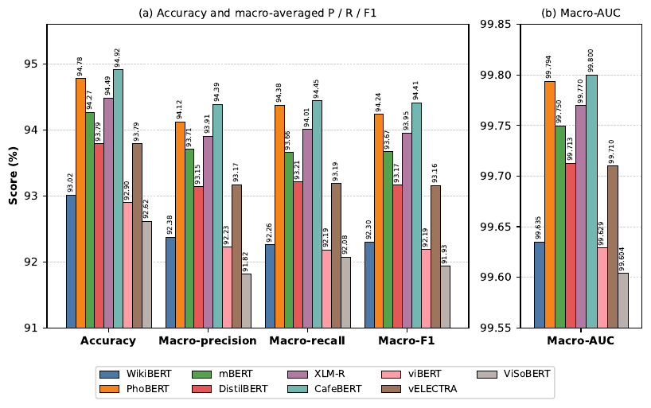
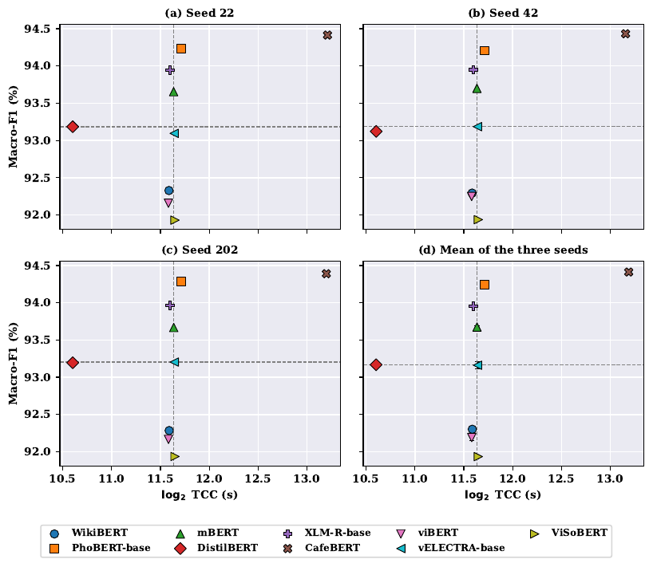

# Benchmarking transformer encoders for large-scale Vietnamese news classification


Code, results and figures for the manuscript

> **Benchmarking transformer encoders for large-scale Vietnamese news classification: performance and computational trade-offs**
> Bao Nhan Chau and Phuoc Tran. *Under review at PLOS ONE* (manuscript PONE-D-26-38656).

Nine publicly available transformer encoders (WikiBERT, PhoBERT-base, mBERT, DistilBERT, XLM-R-base,
CafeBERT, viBERT, vELECTRA-base, ViSoBERT) are fine-tuned under one shared protocol on the
BN-VN3S corpus (946,696 articles, ten categories, three Vietnamese publishers, 2019–2025) and compared
on predictive performance and total computational cost (TCC = fine-tuning + test-inference wall-clock time).

## Main results (held-out test set, 94,670 articles, mean over seeds 42 / 22 / 202)

| Model | Accuracy (%) | Macro-F1 (%) | Macro-AUC | Mean TCC (s) |
|---|---|---|---|---|
| CafeBERT | 94.92 | 94.41 | 0.99800 | 9,335.51 |
| PhoBERT-base | 94.78 | 94.24 | 0.99794 | 3,360.89 |
| XLM-R-base | 94.49 | 93.95 | 0.99770 | 3,099.05 |
| mBERT | 94.27 | 93.67 | 0.99750 | 3,181.59 |
| DistilBERT | 93.79 | 93.17 | 0.99713 | 1,554.86 |
| vELECTRA-base | 93.79 | 93.16 | 0.99710 | 3,192.59 |
| WikiBERT | 93.02 | 92.30 | 0.99635 | 3,077.08 |
| viBERT | 92.90 | 92.19 | 0.99629 | 3,065.10 |
| ViSoBERT | 92.62 | 91.93 | 0.99604 | 3,211.82 |

Per-run values: [`results/per_run_metrics_8models.csv`](results/per_run_metrics_8models.csv),
[`results/cafebert_per_run_metrics.csv`](results/cafebert_per_run_metrics.csv),
[`results/tcc_per_run.csv`](results/tcc_per_run.csv).

<p align="center">
  <br>
  <em>Mean test-set metrics (value above each bar).</em>
</p>
<p align="center">
  <br>
  <em>Macro-F1 versus log<sub>2</sub> TCC per seed (a–c) and averaged over seeds (d).</em>
</p>

## Additional analyses (revision)

| Question | Result | Files |
|---|---|---|
| Is CafeBERT's lead over PhoBERT-base statistically and practically meaningful? | Paired bootstrap / McNemar on the same 94,670 articles: ΔMacro-F1 = +0.22 pp (95% CI 0.09–0.35, seed 42) and +0.19 pp (0.06–0.32, seed 22); 136–177 net articles, at 2.78× the TCC | `results/paired_tests_cafebert_vs_phobert.csv` |
| How many articles are truncated at 256 tokens? | 90.6 % (PhoBERT) to 98.1 % (ViSoBERT) of test articles; median retained share 24–47 % | `results/truncation_stats_test.csv`, `results/truncation_performance_test.csv` |
| Do duplicates across partitions inflate the scores? | 994 test articles (1.05 %) have an exact or near duplicate (MinHash, Jaccard ≥ 0.8) in train/dev; removing them changes macro-F1 by +0.21 to +0.23 pp, ranking unchanged | `results/duplicates_summary.csv`, `results/duplicates_rescored.csv` |
| How stable is performance over time? | PhoBERT-base trained on 2019–2022: macro-F1 93.47 (2019–2022 test) → 92.54 (2023) → 92.11 (2024) → 90.76 (2025) | `results/sensitivity_experiments_phobert.json` |
| Head-only vs head+tail truncation (PhoBERT-base, seed 42, batch 512) | 93.96 → 95.42 macro-F1; part of the gain is attributable to related-article teasers at the end of articles (≥ 25 % of a random sample, 86 % same category) | `results/sensitivity_experiments_phobert.json`, `results/tail_teaser_check.txt` |
| Per-category performance | Lifestyle, Politics and Law are the hardest categories for all checkpoints | `results/per_class_f1_per_run.csv` |

## Repository layout

```
src/finetune.py            fine-tuning + evaluation of one (model, seed) run
analysis/                  revision analyses (statistics, truncation, duplicates, GPU sensitivity runs, teaser check)
notebooks/NB1 ... NB5      self-contained Google Colab notebooks that run the analyses
figures/                   figures and the scripts that draw them
results/                   all numbers reported in the paper and in the response to reviewers
```

`src/finetune.py` re-implements the fine-tuning protocol described in the Methods section of the paper
(maximum length 256 tokens, AdamW with linear decay after 6 % warm-up, three epochs, BF16, epoch-level
model selection on development macro-F1); every setting is a command-line argument. The released
fine-tuned checkpoints, their `trainer_state.json` training logs and the article-level test predictions
are on Hugging Face: <https://huggingface.co/collections/BaoNhan/plos-one>.

## Data

BN-VN3S is described in Chau, Duong & Tran, *IEEE Access* 14 (2026) 109797–109808, doi:[10.1109/ACCESS.2026.3711994](https://doi.org/10.1109/ACCESS.2026.3711994). Article texts are copyrighted by the publishers and
are not redistributed here. The corpus metadata (URL, label, publisher) is available at
<https://huggingface.co/datasets/BaoNhan/Vietnam_News_3_Sources>; the processed splits used for training
(`BaoNhan/Vietnamese_News_Cleaned_3_Sources_Split`, `BaoNhan/Vietnamese_News_PhoBERT_Segmented`) are
available from the authors on request for research use.

## Reproducing

```bash
pip install -r requirements.txt
huggingface-cli login                                 # access to the datasets above
python src/finetune.py --model PhoBERT --seed 42 --out runs/
python figures/scripts/make_fig4_metrics.py figures/generated
python figures/scripts/make_fig5_cost_and_tables.py   # Fig 5, per-category F1, unpaired bootstrap
```

The revision analyses run end-to-end in Colab: open `notebooks/NB1`–`NB5` and choose *Run all*
(NB1, NB2, NB5: CPU high-RAM; NB3, NB4: GPU).

## Citation

The citation will be updated when the article is published.

```bibtex
@misc{chau2026benchmarking,
  title  = {Benchmarking transformer encoders for large-scale Vietnamese news classification:
            performance and computational trade-offs},
  author = {Chau, Bao Nhan and Tran, Phuoc},
  year   = {2026},
  note   = {Manuscript under review at PLOS ONE},
  url    = {https://github.com/chaubaonhan/chaubaonhan-vietnamese-news-encoder-benchmark}
}
```

## License

Code: MIT (see `LICENSE`). Pre-trained base checkpoints keep the licences of their original authors.
